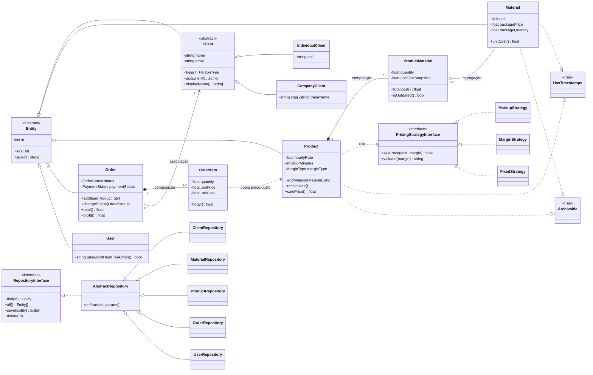

# Arquitetura e modelagem — Phobos PHP

## Visão geral

Arquitetura em camadas, sem framework:

```
Requisição → public/index.php → Router → Controller → Repository (PDO) → PostgreSQL
                                             │              ▲
                                             ▼              │
                                        Models (regras)   hidratação
                                             │
                                           View
```

- **Controller**: valida a entrada (`Validator`), chama o domínio e escolhe a view.
- **Models**: regras de negócio e invariantes (nada de SQL aqui).
- **Repositories**: único lugar com SQL; sempre consultas parametrizadas.
- **Core/Support**: infraestrutura (roteador, sessão, CSRF, upload, formatação).

## Diagrama de classes (UML)



## Modelo de dados (PostgreSQL)

`users`, `clients`, `materials`, `products`, `product_materials` (composição), `orders`, `order_items`.
Script completo em [`database/schema.sql`](../database/schema.sql). Destaques:

- colunas **geradas** pelo banco: `materials.unit_cost`, `products.total_cost`, `orders.total`;
- `CHECK` de integridade (quantidade > 0, margem sobre a venda < 100%, PF×PJ exige CPF *ou* CNPJ);
- chaves estrangeiras `RESTRICT` onde apagar quebraria histórico (material em produto, produto em ordem, cliente com ordem) e `CASCADE` nas partes de uma composição;
- índices únicos de identidade (material: nome+marca+variação; produto: nome+variação).

## Mapeamento requisito → implementação

| Requisito do roteiro | Onde está |
| --- | --- |
| **Encapsulamento** | Propriedades `private`/`protected` com getters e setters que validam invariantes (`Material::setPackage`, `Order::setAdjustments`, `User::changePassword`). Nenhuma entidade é alterada “por fora” sem passar pelas regras. |
| **Herança** | `Entity` → `Client` → `IndividualClient` / `CompanyClient`; `Entity` → `Material`, `Product`, `Order`, `User`; `AbstractRepository` → repositórios concretos. |
| **Polimorfismo** | `Client::document()/documentLabel()/displayName()` (CPF×CNPJ, nome fantasia); `PricingStrategyInterface` com três estratégias intercambiáveis escolhidas por `PricingStrategyFactory`; `Entity::label()`. |
| **Associação** | `Order` → `Client` (a ordem referencia um cliente que existe independente dela). |
| **Agregação** | `ProductMaterial` → `Material`: o material vive sem o produto (e é compartilhado entre produtos). |
| **Composição** | `Product` ◆ `ProductMaterial` e `Order` ◆ `OrderItem`: as partes só existem dentro do todo (`ON DELETE CASCADE`, recriadas junto com o pai). |
| **Interfaces e abstração** | `RepositoryInterface`, `PricingStrategyInterface`; classes abstratas `Entity`, `Client`, `AbstractRepository`. |
| **Traits** | `HasTimestamps` (datas) e `Archivable` (arquivamento lógico) reutilizados por `Material` e `Product`. |
| **Enums (PHP 8.1)** | `OrderStatus` com máquina de estados (`next()`, `canTransitionTo()`), `MarginType`, `Unit`, `PersonType`, `PaymentStatus`. |
| **PDO + CRUD** | `src/Repositories/*`: `find`, `all`, `save` (INSERT/UPDATE), `delete`; `Core/Database` configura PDO com exceções e prepared statements reais (`EMULATE_PREPARES=false`). |
| **Integridade** | Transações em `ProductRepository::save` e `OrderRepository::save` (cabeçalho + itens atômicos); numeração de ordens com `pg_advisory_xact_lock`; constraints no banco; tradução de erros `23503`/`23505` em mensagens de domínio. |
| **Segurança** | Consultas parametrizadas; escape de saída (`e()`); token **CSRF** em todo POST; senhas com `password_hash`; `session_regenerate_id` no login; cookies `HttpOnly`/`SameSite`; upload validando conteúdo real (`getimagesize`), limite de 5MB e nome aleatório; preço/custo dos itens **sempre** lidos do cadastro (nunca do formulário); controle de acesso por perfil (`admin`/`member`) aplicado no servidor (`requireAdmin()` → 403) e refletido na interface; cadastro público sempre cria `member` (só a 1ª conta é `admin`); troca de senha exige a senha atual; ninguém altera o próprio perfil nem exclui a própria conta. |
| **Validação / exceções** | `Core\Validator` (entrada) + `DomainException` (regras de domínio) tratadas no controller com retorno do formulário. |

## Decisões de projeto

1. **Snapshot de custo** (`ProductMaterial::unitCostSnapshot`): alterar o preço de um insumo não muda produtos já salvos até o usuário pedir “Recalcular”; a tela destaca linhas desatualizadas.
2. **Itens da ordem congelam preço e custo** na inclusão, preservando o histórico e o lucro real.
3. **Ordem só é editável em rascunho**; depois disso só avança de status (transições válidas centralizadas em `OrderStatus`) e registra pagamento.
4. **Sem framework/Composer**: autoloader PSR-4 próprio em `src/autoload.php`, para facilitar a execução e deixar o código do próprio time à mostra.
5. **Banco calcula o que é derivado** (custo unitário, custo total, total da ordem) e a aplicação grava os agregados (custos de insumos/mão de obra, subtotal) na mesma transação.

## Limitações e evolução

- Sem testes de integração automatizados com banco (apenas testes unitários do domínio em `tests/run.php`).
- Um único tenant (a versão Next.js original é multiempresa).
- Possíveis evoluções: recuperação de senha por e-mail, perfis mais granulares, paginação, relatórios, emissão fiscal.
